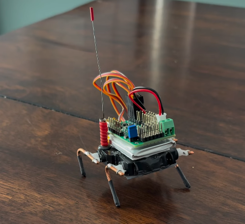

# Micro Crawler: 4 x 2 g Servos

A tiny four-legged crawler with one 2 g micro servo per leg, driven by an
Arduino Pro Micro.

## Builds

I've built several of these crawlers. All of them use the same four 2 g micro
servos, one per leg.

- **First build (pictured):** a Pololu Mini Maestro servo controller powered by
  a 3.7 V LiPo battery.
- **Later builds:** an Arduino Pro Micro running the sketches in this
  repository, with a DC-DC step-up converter for 5 V operation.

| Sketch | Gait |
|---|---|
| `quad_crawl_test/` | Diagonal-pair crawl: each diagonal pair lifts fast and plants slowly while the other pair supports the body |
| `scoutwalker_2_2/` | LANL ScoutWalker-style phase opposition: one diagonal pair drives the power stroke while the other recovers |

## Wiring (Arduino Pro Micro)

| Leg | Pin |
|---|---|
| Front left | 16 |
| Front right | 8 |
| Back left | 14 |
| Back right | 7 |

## Calibrate first

Both sketches have a calibration mode (set at the top of the sketch). It
centers every servo at 90 degrees for fitting the horns, then lets you jog one
leg at a time over the Serial Monitor to find each leg's lift and plant
angles. Enter those angles in the arrays, switch to gait mode and upload.

## License

MIT. See [LICENSE](LICENSE).
